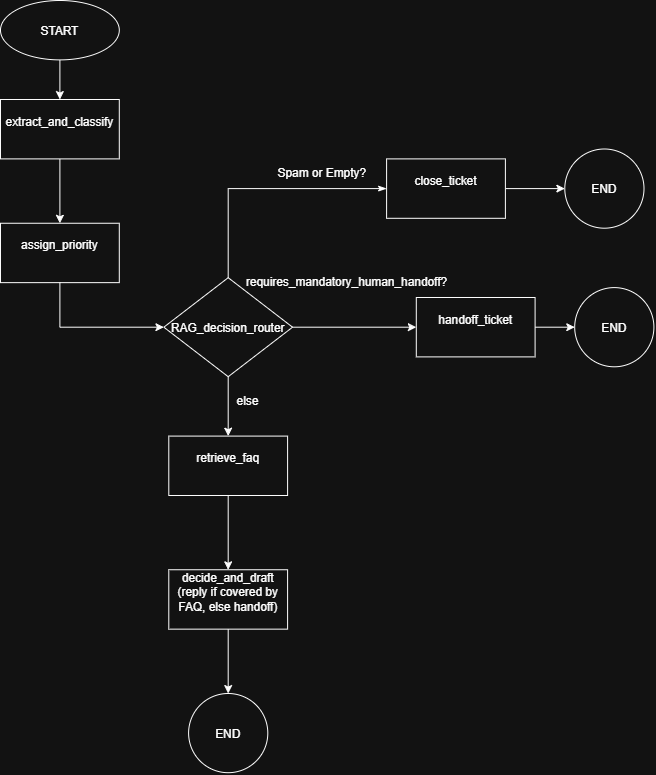

## SUPPORT-AGENT-ASSIGNMENT

Automated customer support triage pipeline built with **LangGraph**, **AWS Bedrock**, and **httpx** that classifies incoming tickets, retrieves Dutch/English/German FAQ context, drafts grounded replies or human handoffs, and submits idempotent API decisions.



## setup:

this is a uv project:

follow the setup to sync the project:

```bash
cd Support Agent Assginment
uv sync
```

To run evals:

```bash
cd '.\src\support_agent_assignment\Evals'
uv run evals.py
```

To run the script:

```bash
cd '.\src\support_agent_assignment\'
uv run main.py
```

## REQUIRED ENVIROMENT VARIABLES

since this project uses AWS bedrock for foundation model, please enable bedrock and embeddings in your AWS console:

```env
Candidate_Email=
HELPDESK_BASE_URL=
API_KEY=
AWS_ACCESS_KEY_ID=
AWS_SECRET_ACCESS_KEY=
AWS_REGION_NAME=
```

## AGENT STATE

```python
class AgentState(TypedDict):
    ticket: Ticket
    facts: TicketFacts | None
    priority: str | None
    faq_chunks: list[str]
    action: str | None
    payload: dict | None
```

## Decisions

Hybrid LLM Extraction + Deterministic Rules: The LLM extracts structured boolean signals (TicketFacts), while Python code deterministically assigns priority (P1–P4) and mandatory escalations (refunds, GDPR, contract changes, multi-user outages). This eliminates priority drift and guarantees policy compliance.

## Reliability

PII Redaction & Prompt Injection Defense: Regex scrubbing redacts IBANs and card numbers before LLM calls, API submissions, and logging. Customer text is isolated inside `<customer_ticket>` tags and treated strictly as data.

## Eval and fix

Eval Result: Achieved 10/10 exact match (language, category, priority, action) on GET /examples (E01–E10).